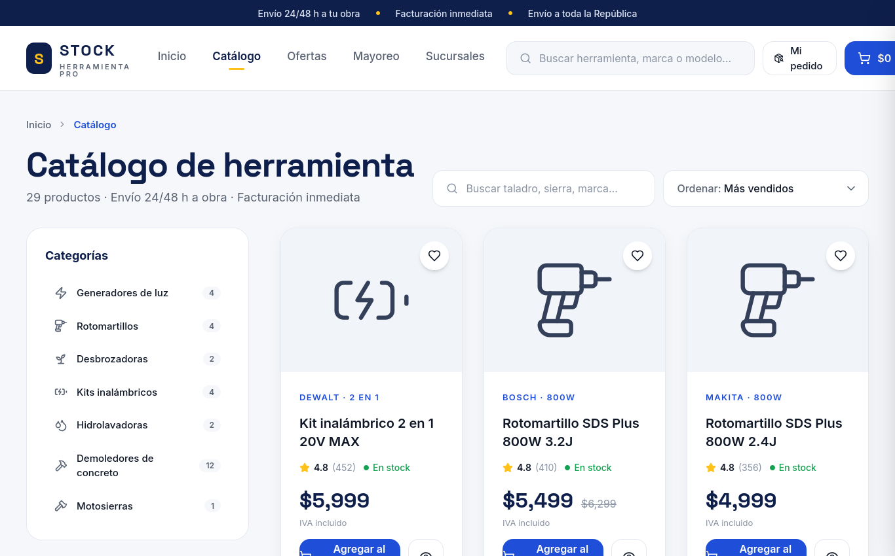
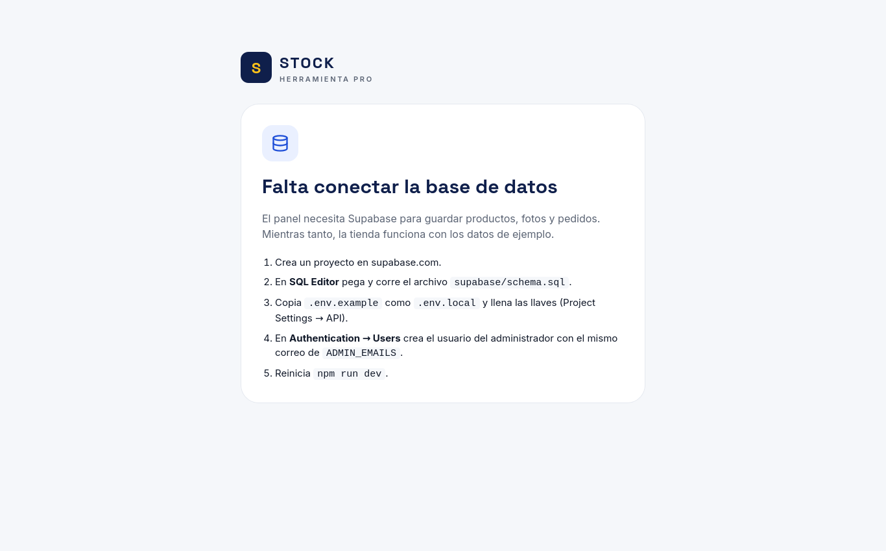

# 📦 Stock Herramienta Pro — E-commerce & Panel de Inventario en Tiempo Real

[](https://nextjs.org/)
[](https://react.dev/)
[](https://www.typescriptlang.org/)
[](https://tailwindcss.com/)
[](https://supabase.com/)
[](https://www.postgresql.org/)

Plataforma full-stack de comercio electrónico y gestión operativa para negocios de distribución y venta de herramientas/maquinaria. Diseñada para sustituir el control manual en hojas de cálculo por un flujo centralizado: catálogo público de alta conversión, checkout transaccional directo a WhatsApp y panel administrativo con control estricto de inventario.

---

## 📸 Capturas de la Plataforma

### 1. Portada y Catálogo Principal
Vista de inicio con banners de oferta, buscador en tiempo real, categorías y llamadas a la acción comerciales.


### 2. Catálogo Interactivo con Filtros Dinámicos
Filtrado por marcas, categorías, rango de precio, ordenamiento y control de stock disponible.


### 3. Ficha Técnica de Producto & Conversión
Detalle de producto con cálculo dinámico de descuentos, especificaciones técnicas y adición rápida al carrito.


### 4. Panel de Control Administrativo (`/admin`)
Gestión centralizada de stock, pedidos entrantes, catálogo de productos y alertas de inventario bajo.


---

## ⚡ Características Principales

### 🛒 Experiencia de Compra (Storefront)
- **Catálogo Dinámico:** Filtrado instantáneo por categoría, marca, precio y disponibilidad.
- **Carrito Persistente:** Cálculo automático de subtotales, promociones y piezas en tiempo real.
- **Checkout directo a WhatsApp:** Generación automática del resumen estructurado del pedido con un clic, conectando al cliente directamente con el equipo de ventas de la sucursal más cercana.
- **Módulo de Ofertas:** Sistema de descuentos por porcentaje y cuenta regresiva diaria.

### 🛡️ Panel de Gestión Administrativa (`/admin`)
- **Control Atómico de Inventario:** Los pedidos descuentan stock a nivel de base de datos de forma transaccional; si se cancela una orden, las piezas se reincorporan automáticamente.
- **Alertas de Stock Crítico:** Identificación visual de productos agotados o próximos a agotarse.
- **CRUD Completo de Catálogo:** Creación y edición de productos, subida de imágenes a bucket de almacenamiento y control de visibilidad en tienda.
- **Seguridad y Permisos:** Autenticación protegida por roles para administradores mediante Supabase Auth y validación en servidor.

---

## 🛠️ Stack Tecnológico

| Capa | Tecnología | Propósito |
|---|---|---|
| **Frontend** | Next.js 15 (App Router) + React 19 | SSR, Server Components y rendimiento optimizado |
| **Lenguaje** | TypeScript 5.6 | Tipado estricto y prevención de errores en compilación |
| **Estilos** | Tailwind CSS v4 | Diseño responsivo moderno y estilizado sin sobrecarga |
| **Base de Datos** | PostgreSQL (Supabase) | Persistencia relacional, transacciones ACID y RPCs |
| **Almacenamiento** | Supabase Storage | Gestión y entrega de imágenes de catálogo |
| **Iconografía** | Lucide React | Iconos vectoriales limpios y accesibles |

---

## 🚀 Instalación y Puesta en Marcha

### 1. Clonar el repositorio
```bash
git clone https://github.com/https-Gabo/stock_.git
cd stock_
```

### 2. Instalar dependencias
```bash
npm install
```

### 3. Configurar Variables de Entorno
Copia el archivo `.env.example` a `.env.local`:
```bash
cp .env.example .env.local
```

Configura tus credenciales de Supabase:
```env
NEXT_PUBLIC_SUPABASE_URL=tu_supabase_project_url
NEXT_PUBLIC_SUPABASE_ANON_KEY=tu_supabase_anon_key
SUPABASE_SERVICE_ROLE_KEY=tu_service_role_key
ADMIN_EMAILS=tu_correo@ejemplo.com
```

> **Nota:** La aplicación cuenta con un modo de respaldo con datos de prueba (*mock data*) para poder visualizar la tienda y el catálogo completo inmediatamente sin necesidad de conectar la base de datos de inmediato.

### 4. Inicializar la Base de Datos (Opcional)
Ejecuta el script SQL en el editor de Supabase:
```bash
cat supabase/schema.sql
```

### 5. Iniciar Servidor de Desarrollo
```bash
npm run dev
```
Abre [http://localhost:3000](http://localhost:3000) en tu navegador para ver la tienda en vivo.

---

## 📂 Arquitectura del Proyecto

```
stock/
├── docs/
│   └── screenshots/         # Capturas de pantalla de la plataforma
├── public/                  # Activos estáticos e imágenes de productos
├── src/
│   ├── app/
│   │   ├── (tienda)/        # Rutas públicas (catálogo, ofertas, checkout)
│   │   ├── admin/           # Panel administrativo y acciones de servidor
│   │   └── layout.tsx       # Layout global y fuentes
│   ├── components/          # Componentes modulares (UI, tablas, modal)
│   ├── lib/
│   │   ├── api.ts           # Capa de abstracción de datos
│   │   ├── admin-data.ts    # Consultas y mutaciones del panel
│   │   ├── db.ts            # Mapeo de datos relacionales
│   │   └── supabase/        # Clientes y conexión de base de datos
│   └── types/               # Definiciones e interfaces de TypeScript
└── supabase/
    └── schema.sql           # Esquema completo de BD, políticas RLS y triggers
```

---

## 👤 Autor
Desarrollado por **Gabriel Juárez**
- GitHub: [@https-Gabo](https://github.com/https-Gabo)
- LinkedIn: [Gabriel Juárez Ramírez](https://linkedin.com/in/gabriel-juarez-ramirez)
- Correo: `gaby63367@gmail.com`
